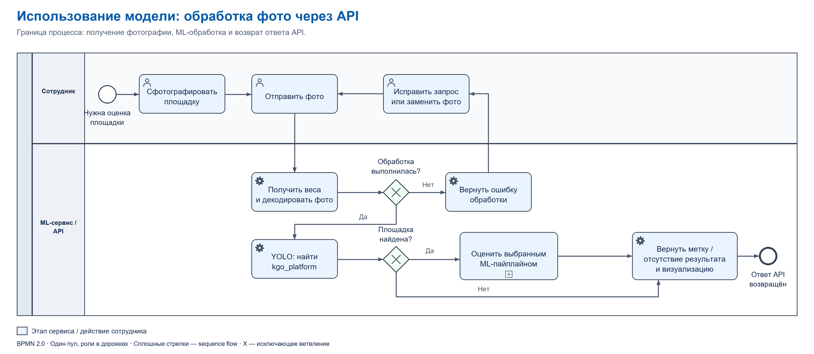
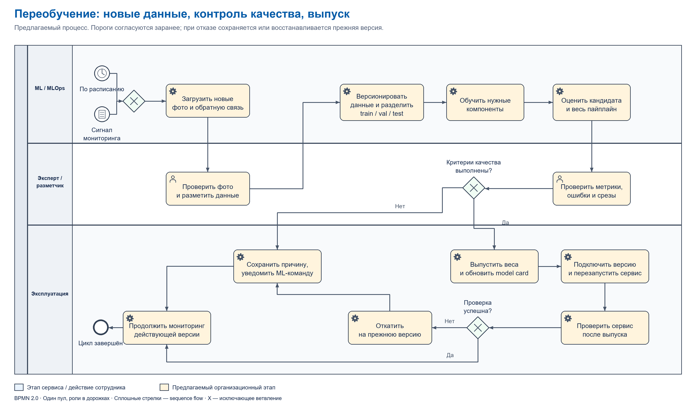

# Определение заполненности площадок КГО по фотографиям

Учебный проект по дисциплине «Проектный практикум»: автоматизация определения заполненности площадок для крупногабаритных отходов (КГО) по фотографиям, которые отправляет сотрудник. Заказчик проекта — **СБЕР**. Результат разработки — сервис с API для обработки фотографий и получения оценки состояния площадки.

Приложение на FastAPI принимает фотографию, запускает выбранный ML-пайплайн и возвращает метку состояния и изображение с результатом. В двух режимах дополнительно рассчитывается доля площади, занятой мусором. Это оценка по двумерному изображению, а не измерение объёма отходов или физической вместимости площадки.

## Содержание

- [Сценарий работы и результаты](#сценарий-работы-и-результаты)
- [Состав проекта и технологии](#состав-проекта-и-технологии)
- [Модели и model cards](#модели-и-model-cards)
- [BPMN: использование модели](#bpmn-использование-модели)
- [BPMN: переобучение модели](#bpmn-переобучение-модели)
- [Быстрый запуск](#быстрый-запуск)
- [Модельные веса](#модельные-веса)
- [Docker](#docker)
- [CI/CD](#cicd)
- [Подготовка датасета и обучение](#подготовка-датасета-и-обучение)
- [Автоматизация разработки](#автоматизация-разработки)

## Сценарий работы и результаты

1. Сотрудник фотографирует площадку и загружает фото через Web-интерфейс или `POST /api/predict`.
2. Приложение получает веса выбранного пайплайна и преобразует изображение в RGB.
3. YOLO ищет объект с именем класса `kgo_platform`.
4. Классификатор или сегментатор оценивает обнаруженную область.
5. Приложение возвращает JSON-ответ с результатом и визуализацией. На этом обработка запроса завершается.

| Значение | Смысл | Как интерпретировать |
| --- | --- | --- |
| `kgo_empty` | Модель относит площадку к незаполненным | Не обязательно полное отсутствие мусора: для сегментации это значение ниже порога |
| `kgo_full` | Модель относит площадку к заполненным | Результат классификации состояния площадки |
| `""`, `predictions: []` | Площадка не найдена или классификатор полного фото выбрал `kgo_none` | Результат отсутствует; это **не** подтверждение пустой площадки |
| `fill_percentage` | Оценка заполненности по маске | Число для SAM/SMP при наличии результата; `null` для режима классификации |

Пайплайны обрабатывают одну выбранную площадку на фотографии: режим классификации берёт первый подходящий bounding box, SAM/SMP — box с максимальной уверенностью. Поддержки полного учёта нескольких площадок в Web/API нет. Уверенность классификаторов используется внутри алгоритма, но в ответ API не передаётся.

## Состав проекта и технологии

| Компонент | Для чего используется | Где находится |
| --- | --- | --- |
| FastAPI, Uvicorn, Jinja2, multipart | HTTP API, загрузка фото и HTML-интерфейс | [fastapi_app](fastapi_app/README.md), [main.py](fastapi_app/main.py), [шаблон](fastapi_app/templates/index.html) |
| PyTorch, Torchvision | Обучение и инференс классификаторов, CPU/CUDA | [classifier_models.py](pipeline/classifier_models.py), training-скрипты |
| Ultralytics YOLO | Поиск границ площадки КГО перед оценкой заполненности | Все три рабочих пайплайна |
| Segment Anything | Энкодер SAM ViT-B с собственным семантическим декодером | [SAM_model/pipeline.py](SAM_model/pipeline.py) |
| Segmentation Models PyTorch | DeepLabV3+ с энкодером SE-ResNeXt50 | [SMP_model/pipeline.py](SMP_model/pipeline.py) |
| Pillow, OpenCV, NumPy, Albumentations | Декодирование, кропы, нормализация, аугментации, маски и визуализация | Обработка фото и датасетов |
| scikit-learn, pandas, matplotlib, seaborn | Разбиение данных, метрики и исследовательские графики | [datasetCreation](datasetCreation), ноутбуки |
| pytest, Ruff, GitHub Actions, Docker | Тесты API/загрузки весов/метрик, lint, сборка и публикация образа | [tests](tests), [CI](.github/workflows/ci.yml), [Dockerfile](Dockerfile) |

## Модели и model cards

| Модель / артефакт | Роль | Статус и карточка |
| --- | --- | --- |
| YOLO, `Yolo26s_kgo.pt` | Общий детектор площадки для трёх режимов | [MC-01: детектор](docs/model-cards.md#mc-01-yolo-детектор-площадки) |
| EfficientNetV2-S, `best_efficientnet_v2_s_kgo.pth` | Два класса по кропу площадки | [MC-02: кроп](docs/model-cards.md#mc-02-efficientnetv2-s-для-кропа) |
| EfficientNetV2-S, `best_efficientnet_for_full.pth` | Три класса по полному фото | [MC-03: полное фото](docs/model-cards.md#mc-03-efficientnetv2-s-для-полного-фото) |
| SAM ViT-B + собственный декодер, `sam_model.pth` | Семантическая сегментация на четыре класса | [MC-04: SAM](docs/model-cards.md#mc-04-sam-vit-b-с-семантическим-декодером) |
| DeepLabV3+ / SE-ResNeXt50, `best_model_SMP.pth` | Семантическая сегментация на четыре класса | [MC-05: SMP](docs/model-cards.md#mc-05-deeplabv3-с-энкодером-se-resnext50) |
| ResNet18/34/50, ConvNeXt-Tiny и исследовательский EfficientNetV2-S | Сравнение бинарных классификаторов кропа | [MC-06: семейство экспериментальных классификаторов](docs/model-cards.md#mc-06-экспериментальные-классификаторы-кропов) |

Результаты сравнения трёх пайплайнов на 235 фотографиях в каждом режиме приведены ниже. Подробности — в [карточке системы MC-07](docs/model-cards.md#mc-07-система-из-трёх-пайплайнов) и [таблице результатов](docs/evaluation/pipeline-metrics-provided.png).

| Pipeline | Total | Accuracy | Macro Precision | Macro Recall | Macro F1 | Weighted F1 | No Zone | Errors |
| --- | ---: | ---: | ---: | ---: | ---: | ---: | ---: | ---: |
| `new_classifier_nodino` | 235 | 0.9404 | 0.9788 | 0.9295 | 0.9534 | 0.9587 | 9 | 0 |
| `sam` | 235 | 0.8000 | 0.9032 | 0.6043 | 0.6320 | 0.7648 | 5 | 0 |
| `smp` | 235 | 0.8681 | 0.8578 | 0.8066 | 0.8298 | 0.8749 | 5 | 0 |

Режим с двумя классификаторами лидирует по accuracy и macro F1 и используется по умолчанию. Доля ответов без зоны составляет 9/235 (**3.83%**) против 5/235 (**2.13%**) у SAM/SMP. Метрики характеризуют полный пайплайн; качество отдельных сегментаторов дополнительно оценивается через IoU/Dice.

Доступные режимы и правила принятия решения:

| Режим | Алгоритм | Выход и порог |
| --- | --- | --- |
| `new_classifier_nodino` (по умолчанию) | YOLO → кроп → EfficientNet на кропе и полном фото; выбирается ответ модели с большей максимальной softmax-оценкой, при равенстве — кроп | `kgo_empty` / `kgo_full`; `kgo_none` превращается в отсутствие результата; процент не рассчитывается |
| `sam` | YOLO → кроп с отступом 8% → SAM-декодер → TTA → очистка маски | `min(100, 100 × A_мусор / (A_пол + A_стена))`; `kgo_full` при значении **≥ 70%** |
| `smp` | YOLO → кроп → DeepLabV3+ → карта классов | `100 × A_мусор / (A_пол + A_стена + A_мусор)`; `kgo_full` при значении **≥ 50%** |

`A` — количество пикселей соответствующего класса. Формулы SAM и SMP имеют разные знаменатели, поэтому проценты и пороги нельзя напрямую сравнивать. При отсутствии пикселей площадки сегментационные функции возвращают нулевую оценку и могут сформировать `kgo_empty`; такой случай требует проверки. В SMP предусмотрен исследовательский параметр `use_floor_only`, но Web/API использует его значение `False`.

## BPMN: использование модели



Диаграмма описывает обработку фотографии в границах сервиса: сотрудник отправляет фото, API получает веса, выполняет детекцию и ML-оценку, затем возвращает ответ. При ошибке обработки входа сотрудник может исправить запрос или заменить фото. Если площадка не найдена, API возвращает отсутствие результата.

Конечное событие — возврат ответа API. Дальнейшее использование результата заказчиком находится за границами проекта и диаграммы. Подпроцесс ML-оценки раскрыт в таблице режимов выше.

## BPMN: переобучение модели



[Открыть SVG](docs/diagrams/model-retraining.svg) · [Редактируемая BPMN 2.0](docs/diagrams/model-retraining.bpmn)

Диаграмма описывает **целевой процесс переобучения**: запуск по расписанию или сигналу мониторинга → сбор и разметка данных → обучение → экспертная валидация → шлюз качества → выпуск версии либо регистрация отказа → мониторинг. После выпуска проверяется работа сервиса; при сбое выполняется откат к предыдущей версии.

1. Запускать цикл при плановом пересмотре или выявленном падении качества, росте доли отсутствующих результатов, появлении новых типов площадок.
2. Собирать новые фото и проверенные ответы, удалять дубликаты, размечать `kgo_platform`, состояние площадки и маски `фон / пол / стена / мусор` для соответствующих моделей.
3. Версионировать данные; разделять train/validation/test по площадкам и сериям съёмки **до** создания кропов. Независимый test не использовать для настройки кандидата.
4. Обучать нужные компоненты, проверять кандидата и весь пайплайн на фиксированной выборке. Эксперт оценивает ошибки и качество разметки.
5. Проверять кандидата по согласованным критериям качества детекции, классификации, сегментации и итогового ответа сервиса.
6. При успешной проверке выпускать новую версию весов, обновлять model cards и конфигурацию, перезапускать сервис и проверять работу. При неудаче сохранять прежнюю версию либо откатывать выпуск, регистрировать причину и возвращаться к мониторингу.

| Объект проверки | Метрики для шлюза качества | Состояние в проекте |
| --- | --- | --- |
| YOLO | mAP@50:95 и recall класса `kgo_platform` на независимых фото | В ноутбуке есть метрики, но разделение train/val требует исправления |
| Классификаторы | Macro F1, recall `kgo_full`, confusion matrix; ROC-AUC только при корректной работе со score | Расчёт бинарных метрик есть; для трёх классов AUC требует отдельного multiclass-расчёта |
| SAM / SMP | IoU/Dice класса мусора и mIoU при одинаковом протоколе оценки | Есть notebook-оценка; методики SAM и SMP различаются |
| Весь сервис | Итоговые F1/recall, доля ответов без метки, ошибок инференса и задержка | Скрипт оценки считает классификационные метрики и количество отсутствующих результатов/ошибок; мониторинг и замер задержки относятся к развитию сервиса |

Критерии приёмки и допустимые отклонения согласуются с заказчиком. Кандидат сравнивается с действующей версией на одинаковой независимой выборке по macro F1, recall `kgo_full`, доле ответов без зоны и ошибкам. Дополнительно проверяются освещение, сезон, тип площадки, камера и ракурс. Результаты конкретного эксперимента не используются как универсальный SLA.

В репозитории реализованы скрипты подготовки данных, обучения и оценки. Автоматическая оркестрация переобучения, мониторинг качества и откат относятся к развитию системы. GitHub Actions отвечает за проверки кода и сборку Docker-образа. BPMN-файлы с `isExecutable="false"` описывают порядок работы. Нотация: [OMG BPMN 2.0.2](https://www.omg.org/spec/BPMN/2.0.2); генератор диаграмм — [generate_diagrams.py](docs/diagrams/generate_diagrams.py).

## Быстрый запуск

```powershell
python -m venv .venv
.venv\Scripts\Activate.ps1
pip install -r fastapi_app\requirements.txt
python -m fastapi_app.run
```

После запуска откройте `http://127.0.0.1:8000`.

HTTPS включается, если передать приложению сертификат и ключ:

```powershell
$env:KGO_SSL_CERTFILE = "C:\certs\localhost.crt"
$env:KGO_SSL_KEYFILE = "C:\certs\localhost.key"
python -m fastapi_app.run
```

В этом режиме приложение слушает HTTPS на `https://127.0.0.1:8443`, а HTTP-запросы на `http://127.0.0.1:8000` перенаправляются на HTTPS с кодом `308`.

API endpoint:

```text
POST /api/predict
```

Form-data:

- `image` - файл изображения.
- `pipeline` - один из `new_classifier_nodino`, `sam`, `smp`.

Пример запроса из PowerShell:

```powershell
curl.exe -X POST http://127.0.0.1:8000/api/predict `
  -F "image=@C:\photos\kgo.jpg" `
  -F "pipeline=smp"
```

Основные поля ответа: `pipeline`, `label`, `bbox`, `fill_percentage`, `predictions`, `annotated_image` (PNG data URL), `checkpoints`. Bounding box в JSON заполняется только режимом SMP; SAM рисует его на фото, но не передаёт координаты в ответ. Список режимов и состояние локальных весов доступны через `GET /api/pipelines`; `GET /api/models` — совместимый альтернативный маршрут. Интерактивное описание API: `http://127.0.0.1:8000/docs`.

## Модельные веса

Файлы `.pt` и `.pth` не хранятся в основном репозитории. Приложение скачивает их при первом запуске выбранного пайплайна из GitHub Releases отдельного репозитория:

```text
https://github.com/likip3/AI-Models/releases/tag/v1
```

Ожидаемые release assets:

- `Yolo26s_kgo.pt`
- `best_efficientnet_v2_s_kgo.pth`
- `best_efficientnet_for_full.pth`
- `sam_model.pth`
- `best_model_SMP.pth`

Настройки по умолчанию:

```powershell
$env:KGO_MODEL_REPO = "likip3/AI-Models"
$env:KGO_MODEL_RELEASE_TAG = "v1"
$env:KGO_MODEL_CACHE_DIR = ".model_cache"
```

Каждый checkpoint можно переопределить локальным путём или прямым URL:

- `KGO_NCD_YOLO_CHECKPOINT`, `KGO_NCD_YOLO_URL`
- `KGO_NCD_CROP_CLASSIFIER_CHECKPOINT`, `KGO_NCD_CROP_CLASSIFIER_URL`
- `KGO_NCD_FULL_CLASSIFIER_CHECKPOINT`, `KGO_NCD_FULL_CLASSIFIER_URL`
- `KGO_SAM_YOLO_CHECKPOINT`, `KGO_SAM_YOLO_URL`
- `KGO_SAM_CHECKPOINT`, `KGO_SAM_URL`
- `KGO_SMP_YOLO_CHECKPOINT`, `KGO_SMP_YOLO_URL`
- `KGO_SMP_CHECKPOINT`, `KGO_SMP_URL`

## Docker

Сборка образа:

```powershell
docker build -t project-urfu-2026 .
```

Запуск:

```powershell
docker run --rm -p 8000:8000 `
  -e KGO_MODEL_REPO=likip3/AI-Models `
  -e KGO_MODEL_RELEASE_TAG=v1 `
  project-urfu-2026
```

После запуска приложение доступно на `http://127.0.0.1:8000`.

Запуск Docker с HTTPS и HTTP -> HTTPS redirect:

```powershell
docker run --rm -p 8000:8000 -p 8443:8443 `
  -v C:\certs:/certs:ro `
  -e KGO_SSL_CERTFILE=/certs/localhost.crt `
  -e KGO_SSL_KEYFILE=/certs/localhost.key `
  project-urfu-2026
```

Доступные переменные:

- `KGO_SSL_CERTFILE` - путь к TLS-сертификату.
- `KGO_SSL_KEYFILE` - путь к TLS-ключу.
- `KGO_HTTPS_PORT` - HTTPS-порт, по умолчанию `8443`.
- `KGO_HTTP_PORT` - HTTP-порт для редиректа, по умолчанию `8000`.
- `KGO_HTTP_REDIRECT` - включает HTTP -> HTTPS redirect, по умолчанию `1` при наличии сертификата.
- `KGO_FORCE_HTTPS` - включает redirect middleware для запуска за reverse proxy.

В Docker image включена переменная:

```text
KGO_PRELOAD_MODEL_ASSETS=1
```

Поэтому контейнер скачивает все модельные веса в `/app/.model_cache` при старте, до начала обработки запросов.
Прогресс скачивания пишется в консоль контейнера с префиксом `[model-assets]`.

Чтобы не скачивать веса заново после каждого запуска, подключите Docker volume:

```powershell
docker run --rm -p 8000:8000 `
  -v kgo_model_cache:/app/.model_cache `
  -e KGO_MODEL_REPO=likip3/AI-Models `
  -e KGO_MODEL_RELEASE_TAG=v1 `
  project-urfu-2026
```

Для отключения preload:

```powershell
docker run --rm -p 8000:8000 `
  -e KGO_PRELOAD_MODEL_ASSETS=0 `
  project-urfu-2026
```

## CI/CD

Workflow [ci.yml](.github/workflows/ci.yml) запускается для pull request в `main` и push в `main`:

- unit tests через `pytest`;
- проверку кода через `ruff`;
- pre-commit-проверки YAML, TOML и конфликтов слияния;
- сборку Docker image после успешных проверок при push в `main`;
- публикацию Docker image в Docker Hub при наличии repository secrets:
  `DOCKERHUB_USERNAME` и `DOCKERHUB_TOKEN`.

Имя публикуемого образа:

```text
DOCKERHUB_USERNAME/project-urfu-2026
```

## Подготовка датасета и обучение

Подготовка датасетов, обучение и исследовательские эксперименты находятся в `datasetCreation`, `NewClassificatorNoDino`, `SAM_model` и `SMP_model`. Описание моделей, параметров и результатов — в [model cards](docs/model-cards.md).

## Автоматизация разработки

Для локальных проверок используется Python 3.11, окружение `venv`, Ruff, pytest и pre-commit. Зависимости проверок перечислены в `requirements-ci.txt`, конфигурация hook — в [.pre-commit-config.yaml](.pre-commit-config.yaml).

В Windows PowerShell из корня Git-репозитория:

```powershell
py -3.11 -m venv .venv
.\.venv\Scripts\python.exe -m pip install --upgrade pip
.\.venv\Scripts\python.exe -m pip install -r requirements-ci.txt
.\.venv\Scripts\python.exe -m pre_commit install
.\.venv\Scripts\python.exe -m pre_commit run --all-files
.\.venv\Scripts\python.exe -m pytest -q
```

Зависимости Web/API перечислены в `fastapi_app/requirements.txt`. Корневой `requirements.txt` предназначен для отдельного исследовательского окружения с CUDA.
